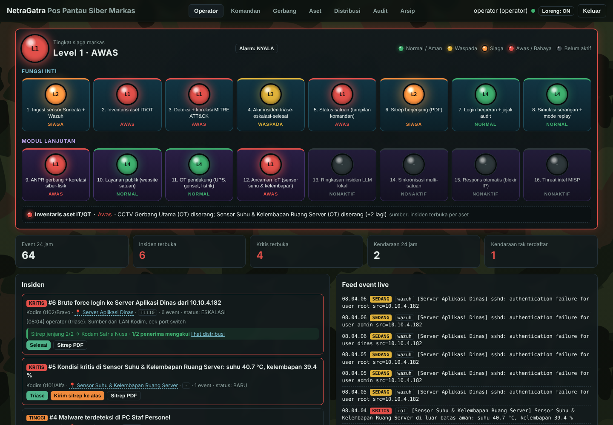
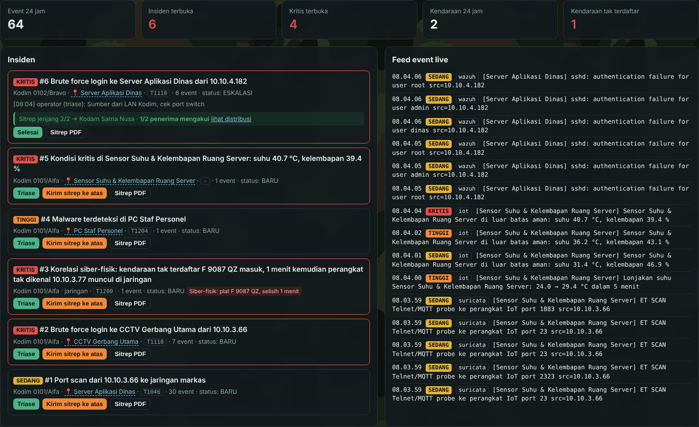
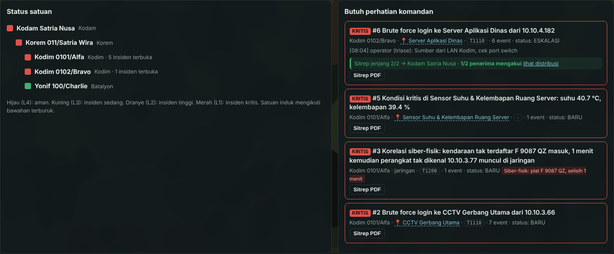
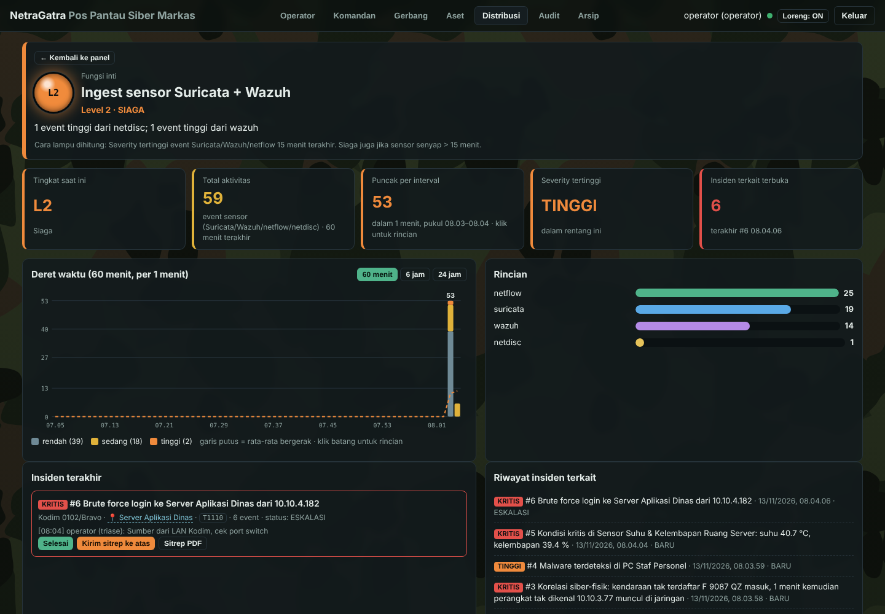
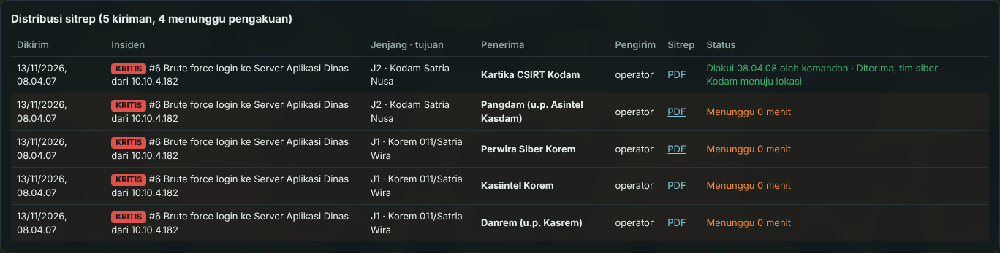
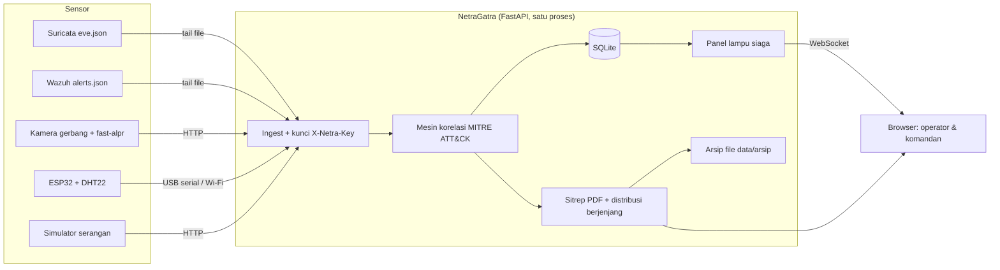

# NetraGatra: Pos Pantau Siber Markas Terpadu

Purwarupa untuk **Kartika Cyber Hackathon 2026, Kategori 3 (Dukungan Teknologi)**.

NetraGatra memantau aset IT dan OT satu markas satuan, mengorelasikan kejadian siber dengan kejadian fisik
di gerbang (plat nomor kendaraan) dan sensor lingkungan, lalu mengubah insiden menjadi lampu siaga dan
sitrep berjenjang yang bisa dibaca komandan tanpa membaca log.

**Berjalan penuh di jaringan lokal satuan, tanpa ketergantungan internet atau cloud (siap air-gapped).** Wazuh, Suricata, ESP32, dan kamera gerbang
tersambung ke NetraGatra lewat LAN satuan, dan tidak ada data yang keluar ke cloud atau internet. Dua bagian opsional
butuh internet: tile peta OpenStreetMap (bisa diganti server tile offline lewat `NETRA_TILE_URL`) dan skrip pengunduh
foto contoh Unsplash (cukup dijalankan sekali).

> Semua nama satuan, aset, plat, penerima sitrep, IP, dan koordinat di repo ini **fiktif**. Nomor satuan
> yang mirip nomor satuan sungguhan hanya kebetulan. Tidak ada data, log, atau foto markas asli di repo ini.



## Masalah yang dipecahkan

- **Alarm tercerai-berai.** IDS jaringan, agen endpoint, CCTV gerbang, dan sensor ruang server berdiri sendiri.
  Kendaraan tamu masuk atau perangkat baru muncul di jaringan, masing-masing biasa saja. Keduanya dalam 10 menit
  adalah pola penyusupan fisik ke jaringan, dan tidak ada satu alat pun yang melihatnya.
- **Komandan tidak membaca log.** Yang dibutuhkan pimpinan adalah status satuan (Normal, Waspada, Siaga, Awas)
  dan siapa sudah melapor ke siapa, bukan ribuan baris event.
- **Laporan berjenjang lambat dan tidak terlacak.** Sitrep sering terlambat atau tidak jelas sudah diterima atau belum.
- **Markas sering tanpa internet.** Solusi berbasis cloud tidak bisa dipakai.

## Kecocokan dengan Kategori 3 (Dukungan Teknologi)

| Kebutuhan | Yang dibangun |
| --- | --- |
| Kesadaran situasi siber satuan | Panel 16 lampu siaga per fungsi, tingkat siaga markas 4 level, status satuan berjenjang Kodam > Korem > Kodim |
| Pengamanan aset IT dan OT | Inventaris aset IT/OT dengan peta, foto 4 sudut, deteksi perangkat tak dikenal, sensor suhu/kelembapan |
| Korelasi siber-fisik | Plat kendaraan tak terdaftar (ANPR) + perangkat baru di jaringan = insiden kritis |
| Komando dan pelaporan | Alur triase-eskalasi-selesai, sitrep PDF otomatis, distribusi berjenjang dengan pengakuan dan eskalasi otomatis |
| Akuntabilitas | Jejak audit setiap aksi, arsip insiden/sitrep di direktori |
| Jalan di markas | Berjalan penuh di jaringan lokal satuan, tanpa ketergantungan internet atau cloud (siap air-gapped). Sensor tersambung lewat LAN. Satu laptop cukup |

## Coba dalam 3 perintah

Butuh Python 3.11-3.13.

```bash
git clone https://github.com/SpektrumIdx/netragatra.git && cd netragatra
pip install -r backend/requirements.txt
cd backend && python -m uvicorn app.main:app --port 8000
```

Buka http://localhost:8000. Password acak operator dan komandan dibuat saat start pertama di
`data/kredensial-awal.txt`. Lalu jalankan skenario serangan dari terminal lain (di folder repo):

```bash
python simulator/simulate.py --skenario demo
```

Alternatif:
- **Windows:** `powershell -ExecutionPolicy Bypass -File .\jalankan-demo.ps1` (password disimpan di `.env`, dibuat acak saat pertama kali; lihat `.env.example`).
- **Docker:** `docker compose up -d --build`, lalu `docker compose exec netragatra cat /data/kredensial-awal.txt`
  dan `docker compose exec netragatra cat /data/ingest.key` (simulator: `--key <isi ingest.key>`).

## Tampilan

| Operator: insiden dan feed event | Komandan: status satuan |
| --- | --- |
|  |  |
| **Detail fitur: alasan lampu, KPI, deret waktu** | **Distribusi sitrep berjenjang** |
|  |  |

## Arsitektur



| Folder | Isi |
| --- | --- |
| `backend/app/` | FastAPI: `main.py` (API, login, WebSocket), `engine.py` (aturan korelasi), `lampu.py` (panel lampu), `sitrep.py`, `distribusi.py`, `arsip.py`, `sensors.py` (pembaca Suricata/Wazuh), `db.py` (SQLite + data contoh fiktif) |
| `backend/static/` | UI tanpa framework dan tanpa CDN (Leaflet disertakan lokal) |
| `simulator/` | Skenario serangan (`simulate.py`) dan pembuat alert berformat Wazuh (`wazuh_alert.py`) |
| `anpr/` | Pekerja pengenalan plat dari kamera RTSP/HP atau input manual |
| `firmware/esp32_dht22/` | Sketch ESP32 sensor suhu dan kelembapan |
| `tools/` | Jembatan serial ESP32, pengunduh foto contoh, pembuat pola loreng |

## Status apa yang nyata dan apa yang masih simulasi

| Bagian | Status |
| --- | --- |
| Server, korelasi, lampu, sitrep PDF, distribusi, audit, arsip | Berjalan dan diuji end-to-end dengan simulator (`--skenario demo`, `iot`, `jenjang`) |
| Docker | Image dibangun dan dijalankan dari clone bersih |
| Wazuh | Pembaca `alerts.json` berformat Wazuh 4.x. Di demo, alert dibuat oleh `simulator/wazuh_alert.py`, **belum diuji dengan manager Wazuh sungguhan** |
| Suricata | Pembaca `eve.json`. Di demo, event dari simulator, **belum diuji dengan sensor Suricata live** |
| ANPR (fast-alpr) | Alur pengiriman diuji. **Akurasi untuk plat Indonesia belum diuji** (malam hari, sudut miring). Cadangan: `--manual` |
| ESP32 + DHT22 | Firmware dan jembatan serial tersedia. Jalur telemetri diuji dengan simulator |
| Peta dasar | Tile OpenStreetMap **butuh internet**. Tanpa internet, pin tetap tampil di latar polos. Peta dasar dapat memakai tile offline (`NETRA_TILE_URL` ke server tile lokal) |
| Foto contoh Unsplash | Tidak disertakan. Pengunduhnya **butuh internet** (sekali saja). `tools/unduh_foto_unsplash.py` tanpa `--key` memakai endpoint publik tak resmi yang bisa berubah |
| Distribusi sitrep | Terjadi di dalam aplikasi, **belum** lewat email/WA/radio |
| Modul 13-16 (LLM lokal, multi-markas, respons otomatis, MISP) | Belum dibangun, tampil abu-abu "Nonaktif" di panel, tidak dihijaukan |

## Rincian teknis

### Demo serangan (mode replay)
```
python simulator/simulate.py --url http://localhost:8000 --keyfile data/ingest.key --skenario demo
python simulator/simulate.py ... --skenario latar --loop     # lalu lintas normal terus-menerus untuk link juri
```
Urutan skenario demo: port scan, brute force CCTV gerbang, kendaraan tak terdaftar masuk,
perangkat tak dikenal muncul (insiden kritis korelasi siber-fisik), malware uji EICAR.

### Sensor nyata
| Sensor | Cara sambung |
| --- | --- |
| Suricata | Arahkan `SURICATA_LOG_DIR` ke folder `eve.json` (port mirror switch markas) |
| Wazuh | Arahkan `WAZUH_LOG_DIR` ke folder `alerts.json` manager Wazuh |
| Wazuh tanpa manager (demo) | `python simulator/wazuh_alert.py --skenario brute` (menulis alert berformat Wazuh ke `sensor-logs/wazuh/alerts.json`) |
| ANPR | `python anpr/anpr_worker.py --source rtsp://...` atau `--source http://IP-HP:8080/video` (butuh `pip install "fast-alpr[onnx]"`) |
| ANPR tanpa kamera | `python anpr/anpr_worker.py --manual --keyfile data/ingest.key` |

### Aturan korelasi
1. Brute force: 5 gagal login ke aset yang sama dalam 60 detik (T1110)
2. Port scan: 15 port berbeda dari satu sumber dalam 30 detik, atau alert Suricata `SCAN` (T1046)
3. Perangkat tak dikenal di jaringan (T1200)
4. Siber-fisik: kendaraan tak terdaftar masuk, lalu perangkat tak dikenal dalam 10 menit (kritis)
5. Malware endpoint dari Wazuh (T1204)

Status satuan 4 level: merah/Awas (L1) jika ada insiden kritis terbuka, oranye/Siaga (L2) jika tinggi,
kuning/Waspada (L3) jika sedang, hijau/Normal (L4) jika aman. Status induk mengikuti satuan bawahan yang terburuk.

### Sensor IoT asli: ESP32 + DHT22
Sensor dikirim langsung ke NetraGatra di laptop, tanpa cloud (Google Sheet/Firebase tidak dipakai, data tidak keluar ke internet).

1. Rakit: DHT22 VCC→3V3, GND→GND, DATA→GPIO 4 (DHT22 4 pin tanpa modul: resistor 10k DATA↔VCC).
2. Arduino IDE: pasang board "esp32" (Espressif) + library "DHT sensor library" (Adafruit) dan "Adafruit Unified Sensor",
   buka `firmware/esp32_dht22/esp32_dht22.ino`, upload. Serial Monitor 115200 harus menampilkan `{"suhu":..,"kelembapan":..}`.
   **Tutup Serial Monitor** sebelum langkah 3 (port COM hanya bisa dipakai satu program).
3. Laptop: `pip install pyserial` lalu `python tools\jembatan_serial.py` (port dicari otomatis; atau `--port COM5`).
   Data masuk sebagai aset `--aset-ip` (default 10.10.3.51 = Sensor Suhu & Kelembapan Ruang Server).
4. Simulator latar jangan menimpa sensor asli: `python simulator\simulate.py --skenario latar --loop --sensor-asli 10.10.3.51`.

Mode Wi-Fi (opsional): isi `WIFI_SSID/WIFI_PASS/NETRA_URL/NETRA_KEY` di sketch, jalankan server dengan `jalankan-demo.ps1 -Lan`,
izinkan port 8000 di Windows Firewall. Rentan di Wi-Fi lomba (client isolation), jadi USB serial adalah jalur utama demo.

Demo di depan juri: hembuskan napas ke DHT22 → kelembapan naik ke 85-90 % (Siaga → Awas, insiden kritis);
genggam sensor → suhu naik ke ~32-34 °C (Waspada); cabut USB → setelah 5 menit lampu IoT "sensor senyap" (Waspada).

### Panel lampu siaga
Satu lampu per fungsi (8 fungsi inti + 8 modul lanjutan), dihitung di `backend/app/lampu.py`
dan disajikan di `GET /api/lampu`. Klik lampu untuk melihat alasannya. Fungsi yang belum dibangun tampil abu-abu
(Nonaktif), tidak dihijaukan. Tingkat siaga markas = lampu aktif yang terburuk. Contoh algoritmanya:
alur insiden menyala merah jika insiden kritis belum ditriase lebih dari 5 menit, sitrep menyala merah jika
insiden kritis belum dilaporkan lebih dari 10 menit, ANPR menyala oranye selama jendela korelasi 10 menit
setelah kendaraan tak terdaftar masuk, dan deteksi menyala kuning saat pola brute force/port scan mendekati ambang.

Saat tingkat siaga Level 1, lampu merah berkedip dan alarm berbunyi (Web Audio, tanpa file suara). Tombol
"Alarm" menyalakan/mematikan bunyi per browser. Browser baru mengizinkan suara setelah ada satu klik di halaman.

Tombol "Situasi tertangani" hanya untuk komandan: wajib konfirmasi dan catatan, menutup semua insiden terbuka,
dan memulai ulang jendela deteksi. Event, insiden, dan jejak audit tidak dihapus (tercatat sebagai `situasi_reset`).
Serangan baru sesudah reset tetap menaikkan level lagi.

Klik lampu yang aktif untuk membuka halaman detail fitur: alasan level, cara lampu dihitung, KPI berwarna per level,
deret waktu (60 menit / 6 jam / 24 jam, grafik SVG tanpa CDN), rincian, insiden terakhir, dan riwayat terkait.

Lampu "Ancaman IoT" membaca telemetri sensor suhu dan kelembapan (`POST /api/ingest/telemetri {ip, suhu, kelembapan}`).
Batas: suhu 30/35/40 °C dan kelembapan 80/85/90 % untuk Waspada/Siaga/Awas, sensor senyap > 5 menit = Waspada,
lonjakan >= 5 °C dalam 5 menit = peringatan tinggi, suhu >= 40 °C = insiden kritis. Demo:
`python simulator/simulate.py --skenario iot` (probe telnet ke sensor, lalu suhu ruang server naik sampai 43 °C).
Skenario `latar` sekarang juga mengirim telemetri normal dari 3 sensor.

### Peta aset dan data aset di direktori
Tab **Aset** menampilkan peta dengan pin per aset (warna = status insiden aset, ukuran = kekritisan) dan tautan
"Buka di Google Maps" untuk setiap aset. Operator bisa menambah/mengedit aset dari form (klik peta untuk mengisi koordinat).

Semua aset juga tersimpan di **`data/aset.json`** dan boleh diedit langsung dengan editor teks: tambah objek baru
(`satuan_id, nama, jenis, kategori, ip, mac, kritis, lat, lon`), ubah, atau hapus. Server membaca ulang file itu otomatis
dalam beberapa detik. File yang rusak diabaikan dan dicatat di audit (`aset_file_tidak_valid`). `-Reset` tidak menghapus aset.json.

Peta dasar memakai Leaflet (tersimpan lokal, tanpa CDN) dengan tile OpenStreetMap, jadi **butuh internet**. Saat offline pin tetap
tampil di latar polos. Untuk markas tanpa internet, jalankan server tile lokal lalu atur
`NETRA_TILE_URL=http://IP-server/tile/{z}/{x}/{y}.png`. Google Maps tidak dipakai sebagai peta dasar karena butuh API key
berbayar dan internet; Google Maps hanya dibuka lewat tautan per aset.

**Koordinat di data contoh fiktif** (area publik). Jangan menaruh koordinat markas asli di repo atau link publik.

#### Foto aset (4 sudut)
Di bawah peta ada galeri 4 foto untuk aset yang dipilih: tampak depan, samping, belakang, dan lingkungan sekitar.
Pilih aset dengan klik pin, klik nama/koordinat di tabel, atau klik nama aset (📍) di kartu insiden: tab Aset terbuka,
peta zoom ke aset itu, dan fotonya tampil.

- **Foto contoh**: jalankan sekali saat online `python tools/unduh_foto_unsplash.py` (opsional `--key ACCESS_KEY` API Unsplash).
  Foto disimpan di `data/foto/stok/<kategori>-1..4.jpg` beserta kredit fotografer, lalu dipakai offline untuk slot yang kosong.
  Foto contoh adalah foto umum per kategori (mis. CCTV), bukan aset yang sama dari 4 sudut.
- **Foto asli**: operator klik "Unggah foto asli" di tiap slot (JPG/PNG/WEBP, maks 8 MB). File disimpan di `data/foto/` dan
  namanya tercatat di `aset.json` (`"foto": [null, "aset-1-2-....jpg", null, null]`). Bisa juga menaruh file sendiri di
  `data/foto/` lalu menulis namanya di aset.json. "Kosongkan" mengembalikan slot ke foto contoh tanpa menghapus file.
- Foto hanya bisa dibuka setelah login (foto markas asli termasuk informasi sensitif).

### Arsip di direktori
Selain di database, NetraGatra menulis arsip file di `data/arsip/` dan menampilkannya di tab **Arsip** (bisa diunduh):

| File | Isi |
| --- | --- |
| `arsip/insiden/insiden-0003.json` | Satu file per insiden (status, catatan, korelasi, daftar event), ditulis ulang setiap insiden berubah |
| `arsip/audit/audit-2026-11-12.jsonl` | Jejak audit harian, satu baris JSON per aksi, hanya ditambah |
| `arsip/sitrep/sitrep-0003-otomatis-triase-20261112-181931.pdf` | Sitrep otomatis setiap insiden muncul dan setiap statusnya berubah (baru, triase, eskalasi, selesai) |
| `arsip/sitrep/sitrep-0003-20261112-181931.pdf` | Sitrep yang diunduh operator/komandan (dihitung "sudah dilaporkan" oleh lampu Sitrep) |

`jalankan-demo.ps1 -Reset` tidak menghapus arsip, tetapi memindahkannya ke `data/arsip-lama/<waktu>/`.
Dengan Docker, data ada di volume `netra-data`; salin dengan `docker compose cp netragatra:/data ./data-salinan`.

### Latar loreng
Latar dashboard memakai pola loreng hutan **orisinal** (`backend/static/loreng.svg`, 60 KB, tile mulus, dibuat oleh
`tools/buat_loreng.py`), diredam gelap agar data tetap mudah dibaca. Bukan salinan motif loreng resmi TNI AD.
Tombol "Loreng: ON/OFF" di kanan atas mematikannya per browser.

### Eskalasi berjenjang dan distribusi sitrep
Sitrep dinaikkan mengikuti hirarki satuan: jenjang 1 = satuan induk (mis. Kodim → Korem), jenjang 2 = induknya lagi (Kodam).
- Operator menekan **"Kirim sitrep ke atas"** (atau status **Eskalasi**) di kartu insiden: sitrep PDF dibuat dengan kolom "Kepada"
  berisi penerima jenjang itu, lalu tercatat satu baris per penerima. **"Teruskan sitrep ke jenjang N"** menaikkan lagi.
- Komandan membuka tab **Distribusi** dan menekan **"Akui"** (dengan catatan) untuk tiap penerima.
- **Eskalasi otomatis**: jika belum ada satu pun penerima yang mengakui dalam batas waktu (default kritis 10 menit, tinggi 30 menit),
  sistem meneruskan ke jenjang berikutnya dan menandainya "otomatis".
- Penerima per tingkat satuan dan batas waktu diatur di **`data/distribusi.json`** (contoh fiktif, bisa diedit, dibaca ulang otomatis).
  Untuk demo, set `"kritis": 1` agar eskalasi otomatis terlihat dalam 1 menit.
- Lampu **Sitrep**: Awas jika insiden kritis belum didistribusikan > 10 menit, Siaga jika sitrep kritis belum diakui,
  Normal jika sudah diakui. Mengunduh "Sitrep PDF" saja tidak dihitung sebagai melapor.
- Distribusi terjadi di dalam aplikasi (offline), belum lewat email/WA/radio.
- Demo: `python simulator/simulate.py --skenario jenjang --op-pass PASSWORD_OPERATOR [--kom-pass PASSWORD_KOMANDAN] [--manual]`.

### Sitrep PDF
Sitrep memuat identitas insiden, korelasi siber-fisik dalam kalimat biasa (plat, kamera, selisih waktu),
**tindakan yang disarankan** per jenis insiden (brute force, port scan, perangkat liar, siber-fisik, malware, IoT),
catatan operator, dan kronologi event.

### Keamanan purwarupa
- Tidak ada password default: kredensial acak dibuat saat start pertama, atau atur `NETRA_USERS`.
- Password di-hash PBKDF2, batas 5 kali gagal login per IP per 5 menit, sesi 8 jam.
- Peran: operator (mengubah status insiden) dan komandan (baca saja).
- Endpoint ingest butuh header `X-Netra-Key`.
- UI merender semua teks event sebagai teks (anti XSS), header CSP dan anti-framing aktif.
- Semua aksi tercatat di jejak audit.
- Untuk akses lewat jaringan, pasang di belakang reverse proxy HTTPS.

## Belum ada (pekerjaan berikutnya)
- Sinkronisasi multi-markas (hub Kodam, spoke Kodim)
- Ringkasan insiden oleh LLM lokal
- Respons otomatis (blokir IP) dengan persetujuan operator
- Uji akurasi ANPR untuk plat Indonesia (malam hari, sudut miring)
- Uji dengan manager Wazuh dan sensor Suricata sungguhan

## Lisensi
Kode NetraGatra dirilis dengan lisensi [MIT](LICENSE). Komponen pihak ketiga dan atribusinya ada di [THIRD-PARTY.md](THIRD-PARTY.md).
